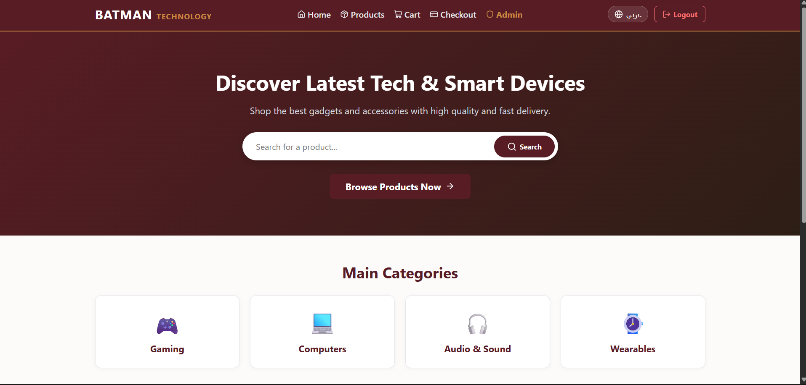

# BATMAN Technology - E-Commerce Web Application

تطبيق متجر إلكتروني حديث ومتكامل لبيع المنتجات والأجهزة الذكية، تم بناؤه باستخدام **React** و **Vite** و **React Router**، مع دعم كامل ثنائي اللغة (العربية والإنجليزية)، ونظام إدارة حالات متقدم، ولوحة تحكم مخصصة للأدمن.

---

## 🛠️ الأدوات والمكتبات المستخدمة
- **React.js** (الإصدار 18+)
- **Vite** (كأداة بناء وتطوير سريعة)
- **React Router DOM v6** (لإدارة المسارات والصفحات)
- **Lucide React** (للأيقونات التفاعلية)
- **CSS Custom Properties** (نظام تصميم باللون العنابي والبرونزي الدافئ)
- **Context API & LocalStorage** (لإدارة السلة والمصادقة واللغة)

---

## ⚙️ متطلبات التشغيل
- **Node.js**: الإصدار 16.0.0 أو أحدث
- **npm**: الإصدار 8.0.0 أو أحدث

---

## 💻 أوامر التثبيت والتشغيل والبناء

1. **تثبيت حزم المشروع**:
   ```bash
   npm install

   تشغيل بيئة التطوير المحلية:
  npm run dev

  بناء المشروع للإنتاج (Production Build):
  npm run build

  معاينة النسخة المبنية:
  npm run preview

  بنية المجلدات (Folder Structure):
  src/
├── components/          # المكونات القابلة لإعادة الاستخدام
│   └── layout/          # مكونات الهيكل العام (Navbar, Footer)
├── context/             # إدارة الحالة المشتركة (AuthContext, CartContext, LanguageContext)
├── data/                # البيانات التجريبية وملفات الترجمة (products.js, translations.js)
├── pages/               # الصفحات الأساسية المطلوبة (10 صفحات)
│   ├── Home.jsx
│   ├── Products.jsx
│   ├── ProductDetails.jsx
│   ├── CartPage.jsx
│   ├── Login.jsx
│   ├── Register.jsx
│   ├── Checkout.jsx
│   ├── Profile.jsx
│   ├── AdminDashboard.jsx
│   └── NotFound.jsx
├── App.jsx              # إعداد الراوتر والمزودات
└── main.jsx             # نقطة الانطلاق الرئيسية

الصفحات والمسارات (Routes)
/: الصفحة الرئيسية (عرض الهوية، البانر، الفئات، والتفتيش السريع)

/products: صفحة الكتالوج (البحث، الفلترة بالسعر والمخزون، والترتيب)

/products/:id: تفاصيل المنتج والمخزون والمنتجات المشابهة

/cart: سلة المشتريات وإدارة الكميات

/login: تسجيل الدخول وإظهار/إخفاء كلمة المرور

/register: إنشاء حساب جديد مع التحقق وتأكيد كلمة المرور

/checkout: إتمام الطلب، العنوان، وطرق الدفع (COD/Visa)

/profile: حساب الزبون وتعديل البيانات وسجل الطلبات

/admin: لوحة تحكم الأدمن (محمية وصالحة للأدمن فقط)

*: صفحة الخطأ 404 للمسارات غير الموجودة

🧩 المكونات الرئيسية (Components)
Navbar & Footer: شريط التنقل المتجاوب والذيل.

ProductCard & CategoryCard: بطاقات عرض المنتجات والتصنيفات.

AuthGuard & ProtectedRoute: حماية المسارات الخاصة بحساب الأدمن أو العميل.

EmptyState & Loader: معالجة الحالات الفارغة وحالات التحميل.

🔑 بيانات الحسابات التجريبية (Demo Credentials)
ملاحظة: الحسابات تجريبية ولا تحتوي على أي أسرار حقيقية.

حساب الأدمن (Admin):

البريد الإلكتروني: admin@batman.com

كلمة المرور: أي كلمة مرور (مثال: 123456)

حساب الزبون (Customer):

البريد الإلكتروني: user@batman.com

كلمة المرور: أي كلمة مرور (مثال: 123456)

📸 صور من التطبيق (App Screenshots) :


🌐 رابط النسخة المنشورة (Live Preview Link)
رابط المعاينة: [ضع رابط Vercel أو Netlify الخاص بكِ هنا]

رابط المستودع على GitHub: [ضع رابط مستودع GitHub هنا]

ℹ️ بيان البيانات والمستقبل (Mock Data Notice)
تنويه هام: يعتمد هذا المشروع حالياً على بيانات محلية تجريبية محاكية (Mock Data) محفوظة داخل مجلد src/data/products.js و LocalStorage. هذا التطبيق مصمم في هذه المرحلة كواجهة أمامية جاهزة ومجهزة بالكامل للربط مع واجهات برمجة التطبيقات (Backend APIs) مستقبلاً دون الحاجة لتعديل جوهري في المكونات